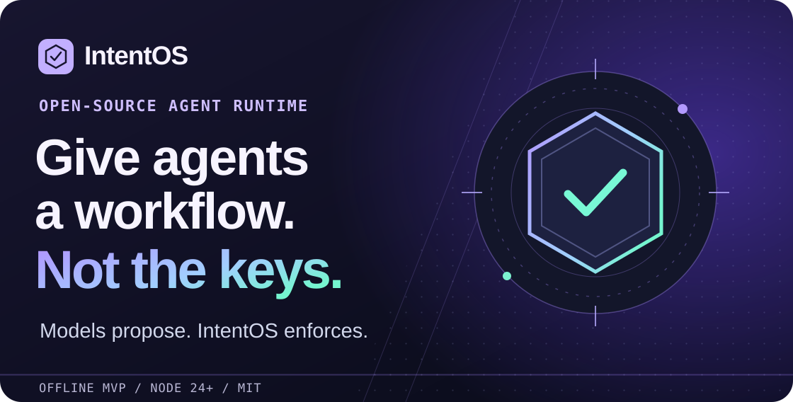
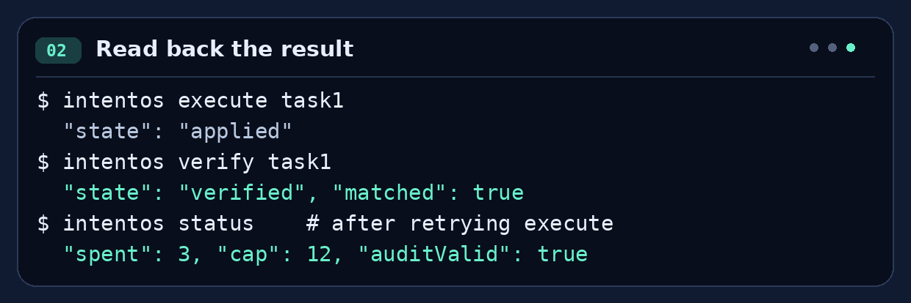
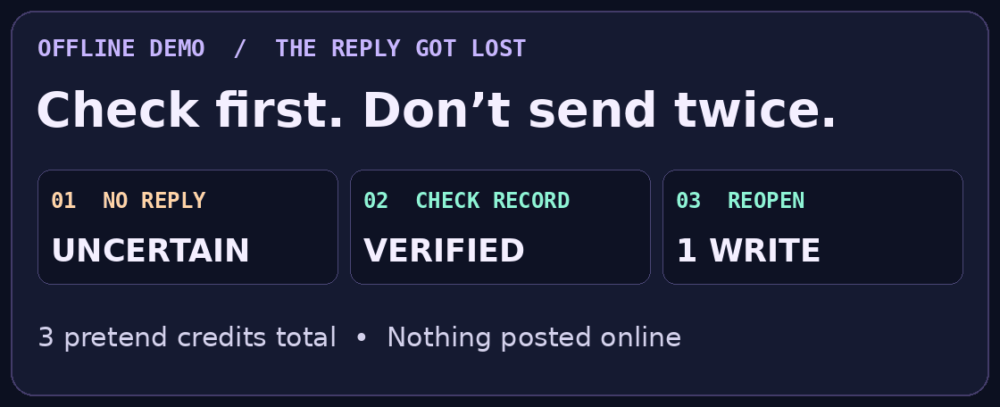

# IntentOS



[](#how-it-works)

**IntentOS helps you stay in control of what AI does on your behalf.** It checks what you approved before anything happens, then checks the result so you know whether it worked.

## How it works

**Imagine asking AI to schedule a post for your shop.**

1. **AI shows you its plan.** You see the exact post and when it would go out.
2. **You decide what goes ahead.** Approving one post doesn't give AI permission to publish a different one. If the plan goes over a limit you set, it stops.
3. **You get proof, not just “done.”** The system checks the destination to see what actually happened.

*That's an example of what IntentOS is designed for. Today's demo uses a pretend service and pretend credits. It doesn't connect to social media, publish anything, or spend real money.*


## Watch it work



*Watch the demo block an unapproved action, confirm an approved one worked, and show that a retry didn’t charge twice. No real money is used.*

<details>
<summary>Watch the optional animated demo and see the approval capture</summary>


The terminal screenshots abbreviate `node src/cli.ts` as `intentos` and use one shared state directory.

</details>

## What if the reply never comes back?

**Your pretend shop saves a post, but its reply gets lost.** Sending it again could create a duplicate. The new offline queue demo stops, checks the shop's saved record, and confirms the original write. It shows **one write and one charge**, even after a restart.

If the record is missing, unclear, or appears more than once, IntentOS leaves it unresolved for a person to review. It doesn't guess that nothing happened and send again.



```sh
npm run demo:queue
npm run demo:queue   # check the same saved result; don't send again
```

*This is a pretend publishing service running on your computer. It isn't connected to a real shop, publishing platform, or social network. The demo deliberately loses a reply; no real post goes out and no money is spent.*

[See the recovery contract and test coverage](docs/QUEUE-RECOVERY.md).

## Try it on your computer

With **Node.js 24+**, clone this repo and run the following in the checkout. The demos and tests need no install, account, API key, or network call once you're in the repo.

```sh
npm run demo
npm run demo   # same local state: no duplicate effect or charge
npm test
```

The demo's built-in approval is for a harmless, fixed fixture. Use the manual flow below to approve a proposal yourself. Local demo state lives in `.intentos/`, which is ignored by Git.

## What the MVP does

| What you want | What the MVP demonstrates |
| --- | --- |
| **Control what runs** | Planner and verifier agents get only their own scoped controls. Approval and execution stay with the trusted host. Approval is tied to the exact action, payload, cost, and policy version. |
| **Stay within a cap** | The runtime checks and charges a fixed cost against a persistent pool of simulated credits before it dispatches the write. |
| **Recover after a crash** | The original simulator recognizes retries. The new pretend publishing queue does not: IntentOS records the attempt first, then checks uncertain results without sending again. Missing or conflicting evidence stops for human review. |
| **Know it really happened** | The verifier reads the service's own record. A durable audit trail records the decisions; executor output alone can't mark an action verified. |

IntentOS is for developers who want predictable action handling without committing to a model provider. The demo uses an offline planner. OpenAI and Anthropic proposal adapters are included and tested with mocked HTTP; they are not needed to run it.

## Give each agent only the controls it needs

The planner can submit proposals in its assigned scope. The verifier can check service evidence in its scope. Neither can approve, execute, or inspect global state. The host passes each agent a narrow interface rather than handing it the runtime.

[See the agent API and a runnable composition example](docs/AGENT-API.md).

## Approve a proposal yourself

```sh
node src/cli.ts propose .intentos/manual task1 'Draft release notes'
# Review the payload and cost, then copy the hash printed above.
HASH='paste-the-displayed-hash-here'
node src/cli.ts approve .intentos/manual task1 "$HASH"
node src/cli.ts execute .intentos/manual task1
node src/cli.ts verify .intentos/manual task1
node src/cli.ts status .intentos/manual
```

Use `deny` instead of `approve` to reject a proposal. Use `recover` with the same state directory to resume the original simulator, then verify the result. For the new queue, recovery reports an uncertain attempt without resending; `verify` checks its evidence. See the [architecture](docs/ARCHITECTURE.md) for guarantees and failure modes.

## What’s ready, and what’s next

**Ready to try:** An offline CLI, two offline simulated adapters, SQLite persistence, and tests for approval, budgets, crash recovery, and independent verification. `npm test` runs without network. For development, pinned tooling adds a separate static check: run `npm ci --ignore-scripts --no-audit --no-fund` and then `npm run typecheck`. The CI workflow also runs the tests and both demos; it does not deploy.

**Not production-ready:** The CLI trusts its local operator and host. Agent capabilities are an application API boundary, not isolation from other Node.js code. It is not a sandbox for untrusted code, does not use real money, and does not promise exactly-once effects for other services. Live model calls are not part of this demo.

**New for developers:** [Read how uncertain writes are reconciled](docs/QUEUE-RECOVERY.md). Live connectors, authenticated operators, and stronger storage recovery remain future work.

[Read the design](docs/ARCHITECTURE.md) · [Contribute](CONTRIBUTING.md) · [MIT license](LICENSE) · [Competitive notes and working name](docs/COMPETITIVE-NOTES.md)
