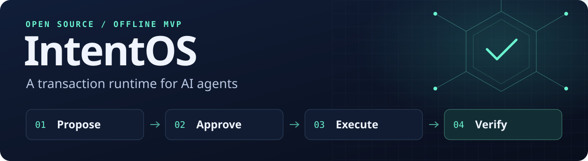

# IntentOS



**Let AI agents propose changes without giving them the keys.**

IntentOS is an open-source transaction runtime for agent workflows. It separates **what a model suggests** from **what your software is allowed to do**. Approve the exact proposal, enforce a budget before acting, and verify what actually happened instead of taking the model's word for it.

**Offline MVP · TypeScript · Node 24+ · SQLite · MIT**

[Try it](#try-it) · [See the demo](#see-the-demo) · [Architecture](docs/ARCHITECTURE.md) · [Roadmap](docs/ROADMAP.md)

## Why IntentOS?

A model can say “done” even if a service never made the change. A human can approve one proposal and the next model call can generate a different one. And if a process dies after a write, replaying it can repeat the effect. IntentOS makes those decisions the runtime's job, not the model's.

| What you want | What the MVP demonstrates |
| --- | --- |
| **Control what runs** | Separate planner, approver, executor, and verifier roles. Approval is tied to the exact action, payload, cost, and policy version. |
| **Stay within a cap** | The runtime checks and charges a fixed cost against a persistent pool of simulated credits before it dispatches the write. |
| **Recover after a crash** | The simulator recognizes the same operation on retry. The included tests kill the process before and after the write and check that recovery doesn't duplicate the effect or charge. |
| **Know it really happened** | The verifier reads the service's own record. A durable audit trail records the decisions; executor output alone can't mark an action verified. |

IntentOS is for developers who want predictable action handling without committing to a model provider. The demo uses an offline planner. OpenAI and Anthropic proposal adapters are included and tested with mocked HTTP; they are not needed to run it.

## Try it

With **Node.js 24+**, clone this repo and run the following in the checkout. No install, account, API key, or network call required once you're in the repo.

```sh
npm run demo
npm run demo   # same local state: no duplicate effect or charge
npm test
```

The demo's built-in approval is for a harmless, fixed fixture. Use the manual flow below to approve a proposal yourself. Local demo state lives in `.intentos/`, which is ignored by Git.

## See the demo

**1. An agent can propose a write, but the runtime won't execute it without exact approval.**


**2. A verifier checks the service record. Replay leaves the budget at 3 of 12 simulated credits.**


These styled captures show excerpts from a real local run. In the screenshots, `intentos` abbreviates `node src/cli.ts` with a common state directory.

## Approve a proposal yourself

```sh
node src/cli.ts propose .intentos/manual task1 'Draft release notes'
# Review the payload and cost, then copy the hash printed above.
HASH='paste-the-displayed-hash-here'
node src/cli.ts approve .intentos/manual task1 "$HASH"
node src/cli.ts execute .intentos/manual task1
node src/cli.ts verify .intentos/manual task1
node src/cli.ts status .intentos/manual
```

Use `deny` instead of `approve` to reject a proposal. Use `recover` with the same state directory to resume interrupted execution, then verify the applied result. See the [architecture](docs/ARCHITECTURE.md) for guarantees and failure modes.

## What’s ready, and what’s next

**Ready to try:** An offline CLI, one simulated write adapter, SQLite persistence, and tests for approval, budgets, crash recovery, and independent verification. `npm test` runs without network. Tests run with Node's native TypeScript support; static type checking is not configured yet.

**Not production-ready:** The CLI trusts its local operator and host. It is not a sandbox for untrusted code, does not use real money, and does not promise exactly-once effects for other services. Live model calls are not part of this demo.

**Next:** [Narrow the agent API](https://github.com/ConfusedDuckCollectibles/IntentOS/issues/1), then [reconcile writes when a service never answers](https://github.com/ConfusedDuckCollectibles/IntentOS/issues/2).

[Read the design](docs/ARCHITECTURE.md) · [Contribute](CONTRIBUTING.md) · [MIT license](LICENSE) · [Competitive notes and working name](docs/COMPETITIVE-NOTES.md)
