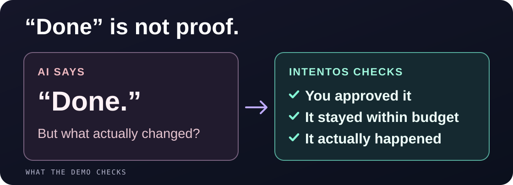
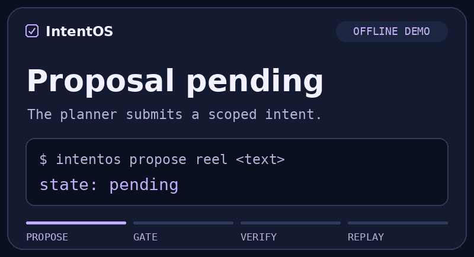
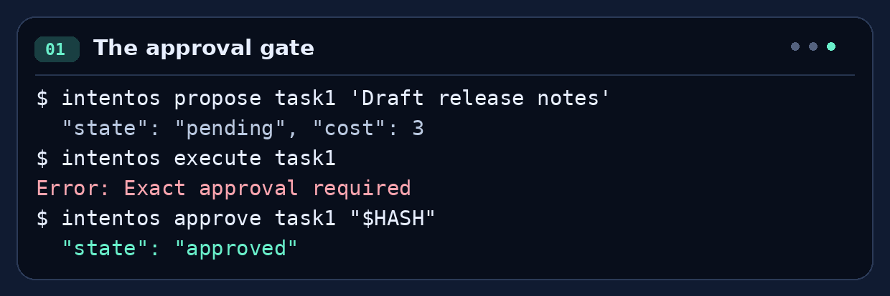

# IntentOS


[](#try-it)

**Open source. Runs locally. No API key required.**

[Try it](#try-it) · [Watch it work](#watch-it-work) · [Agent API](docs/AGENT-API.md) · [Architecture](docs/ARCHITECTURE.md) · [Roadmap](docs/ROADMAP.md)



IntentOS separates **what a model suggests** from **what your software is allowed to do**. Approve the exact proposal, enforce a budget before acting, and verify what actually happened.

## Watch it work



*Real offline CLI output. Simulated credits. No live service or payments.*

<details>
<summary>See the two static terminal captures</summary>




The terminal screenshots abbreviate `node src/cli.ts` as `intentos` and use one shared state directory.

</details>

## Try it

With **Node.js 24+**, clone this repo and run the following in the checkout. No install, account, API key, or network call required once you're in the repo.

```sh
npm run demo
npm run demo   # same local state: no duplicate effect or charge
npm test
```

The demo's built-in approval is for a harmless, fixed fixture. Use the manual flow below to approve a proposal yourself. Local demo state lives in `.intentos/`, which is ignored by Git.

## What the MVP does

| What you want | What the MVP demonstrates |
| --- | --- |
| **Control what runs** | Planner and verifier agents get only their own scoped controls. Approval and execution stay with the trusted host. Approval is tied to the exact action, payload, cost, and policy version. |
| **Stay within a cap** | The runtime checks and charges a fixed cost against a persistent pool of simulated credits before it dispatches the write. |
| **Recover after a crash** | The simulator recognizes the same operation on retry. The included tests kill the process before and after the write and check that recovery doesn't duplicate the effect or charge. |
| **Know it really happened** | The verifier reads the service's own record. A durable audit trail records the decisions; executor output alone can't mark an action verified. |

IntentOS is for developers who want predictable action handling without committing to a model provider. The demo uses an offline planner. OpenAI and Anthropic proposal adapters are included and tested with mocked HTTP; they are not needed to run it.

## Give each agent only the controls it needs

The planner can submit proposals in its assigned scope. The verifier can check service evidence in its scope. Neither can approve, execute, or inspect global state. The host passes each agent a narrow interface rather than handing it the runtime.

[See the agent API and a runnable composition example](docs/AGENT-API.md).

## Approve a proposal yourself

```sh
node src/cli.ts propose .intentos/manual task1 'Draft release notes'
# Review the payload and cost, then copy the hash printed above.
HASH='paste-the-displayed-hash-here'
node src/cli.ts approve .intentos/manual task1 "$HASH"
node src/cli.ts execute .intentos/manual task1
node src/cli.ts verify .intentos/manual task1
node src/cli.ts status .intentos/manual
```

Use `deny` instead of `approve` to reject a proposal. Use `recover` with the same state directory to resume interrupted execution, then verify the applied result. See the [architecture](docs/ARCHITECTURE.md) for guarantees and failure modes.

## What’s ready, and what’s next

**Ready to try:** An offline CLI, one simulated write adapter, SQLite persistence, and tests for approval, budgets, crash recovery, and independent verification. `npm test` runs without network. Tests run with Node's native TypeScript support; static type checking is not configured yet.

**Not production-ready:** The CLI trusts its local operator and host. Agent capabilities are an application API boundary, not isolation from other Node.js code. It is not a sandbox for untrusted code, does not use real money, and does not promise exactly-once effects for other services. Live model calls are not part of this demo.

**Next:** [Reconcile writes when a service never answers](https://github.com/ConfusedDuckCollectibles/IntentOS/issues/2).

[Read the design](docs/ARCHITECTURE.md) · [Contribute](CONTRIBUTING.md) · [MIT license](LICENSE) · [Competitive notes and working name](docs/COMPETITIVE-NOTES.md)
