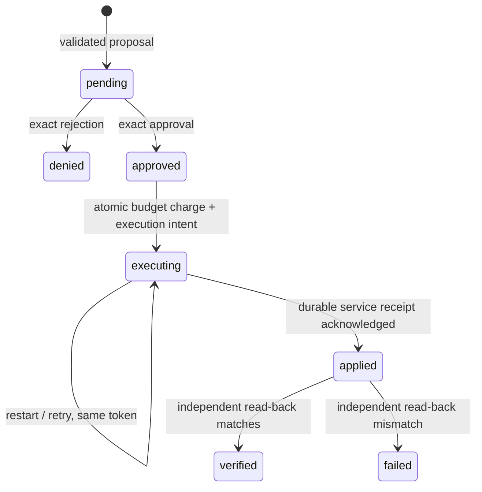

# Architecture and guarantees

## Components and authority

The trusted application constructs `IntentHost`, which privately owns the Runtime and database paths and provisions role-specific capabilities. Planner agents receive only `propose/get/list`; verifier agents receive only `verify/get/list`. These immutable capabilities bind a private host-minted actor to a fixed namespace prefix. Read queries and state-changing operations enforce that scope. Agent code receives no runtime, factory, raw actor token, service, operator, executor, global budget or audit handle. See [Agent API](AGENT-API.md) for the contract and runnable integration example.

The CLI is the trusted composition root. It passes separate capabilities into offline agent functions while retaining approval, execution, recovery and global inspection. Demo auto-approval is fixture setup, not authenticated human consent. Provider adapters import only shared proposal validation and return proposals; they cannot select spend, tools, approval or execution status. The verifier uses deterministic independent read-back, not a model's success claim.

This is a cooperative application API boundary, not a JavaScript or OS sandbox, identity provider or multi-user service. The host must trust module loading, provisioning, authentication, execution scheduling and storage access. Arbitrary Node code with imports/OS access can instantiate the lower-level host-only Runtime or access databases directly. Actor IDs are audit labels, not authenticated identities. Capability references can be deliberately delegated. Scope isolates returned intent data but global ID conflicts can reveal occupancy; there is no tenant-level metadata isolation. No third-party code is loaded by the demo.

## Original simulated adapter state machine

Denied and failed are terminal. Budget exhaustion leaves an approved intent unexecuted, with a denial audit entry. There is no mutable proposal or automatic escalation. A transient adapter error leaves executing work available for explicit recovery. A verifier read error leaves applied work available for retry; a confirmed evidence mismatch becomes failed. Failed evidence is never automatically repaired or hidden.

## Original simulated adapter transaction and crash protocol

1. A runtime transaction checks actor role/scope, exact approval and remaining budget, charges 3 credits, records `executing` and the audit event, then commits.
2. The simulated service opens its own database transaction and inserts `(token, payload, receipt)` only if the token is absent. Existing tokens must match payload exactly.
3. A runtime transaction acknowledges the receipt and records `applied` plus audit.
4. Verification reads the effect through a new read-only SQLite connection and compares the token-bound receipt and exact payload. It then stores evidence, terminal status and audit atomically.

A crash before step 1 commits leaves no charge. A crash after it commits retains both charge and intent. Replaying step 2 can run more than once but creates one ledger row. A crash before acknowledgment commit leaves `executing`; recover safely repeats step 2. Multiple local workers serialize budget changes with SQLite locking; acknowledgment is idempotent. This is at-least-once delivery with an idempotent simulated effect, not a general distributed exactly-once guarantee.

Spend is conservative attempted-execution accounting. Once charged it is never refunded, including failure, missing effects, or verification mismatch. It represents neither live money nor provider token cost. Database cap and spend are safe integers at ingress; each increment is checked against remaining cap within one transaction. Reopening does not reset or raise the cap.

Each runtime database must have its own dedicated service database. Reusing a service database across independent runtimes is unsupported because intent digests have no tenant namespace. Service records are immutable receipts of simulated writes; this MVP does not implement last-write-wins mutable resources, external HTTP side effects, or rollback of real-world actions.

## Audit and limits

Audit entries include actor, operation, details, prior hash and current hash in the same transaction as runtime state changes. Denied operations roll back before a separate denial-audit transaction. If the database itself is unavailable, denial logging is best effort. `checkAudit()` detects modification of existing entries; there is no trusted external checkpoint, signature, timestamp, or protection against a privileged editor rewriting/truncating the entire chain. State transitions do not automatically enforce audit integrity. Local filesystem administrators can modify both state and evidence.

Durability relies on SQLite, the local filesystem, and storage honoring synchronization. Process-death tests are not power-loss, disk corruption, NFS, distributed consensus, or failover tests. The default busy timeout is five seconds; lock-timeout errors require operator retry. Versioned pairing, conservative unversioned adoption and stopped-worker backup/restore are implemented; see [storage](STORAGE.md). Bounded retention, encryption and arbitrary legacy migrations remain unimplemented. Audit and evidence contain proposal text: use nonsensitive demo data.

The crash switches on `execute` intentionally call `process.exit` for test fault injection and must not be exposed to untrusted callers. A provider response is treated as untrusted input and strictly schema-validated; semantic accuracy of arbitrary model prose is outside the verifier's guarantee. Verification proves the requested simulated effect was recorded, not that the user's broader business objective was correct.

The runtime now binds both versioned stores through peer identities and a local pairing anchor, checking them before dispatch and verification. Missing or replaced stores fail closed. Use the complete stopped-worker [backup/restore procedure](STORAGE.md) rather than replacing one file; local identities are not anti-rollback protection against in-place rewrites or filesystem snapshots. Demo auto-approval is fixture setup, not evidence of human authentication or consent in a deployed system.

## Queue adapter: uncertain outcome branch

The second offline adapter is a synthetic publishing queue without backend deduplication. It shares exact approvals, scoped capabilities, conservative integer budget and audit with the original adapter, but never replays a dispatch. Its additive `queue_attempts` table records the authorized attempt before writing. State moves `approved → uncertain → applied` when an acknowledgment arrives; a lost acknowledgment stays `uncertain`. Independent verifier read-back can move `uncertain` or `applied` to `verified` only with one conclusive record. Missing/ambiguous/stale/unavailable/mismatched reads remain `uncertain` for human review. No automatic resend or refund is permitted. See [queue recovery](QUEUE-RECOVERY.md) for the contract, runnable demo, draft-transition evidence and limits.

## Versioned paired storage

Storage format 2 initializes both local stores and an adjacent pairing anchor before runtime use. All ordinary runtime transactions validate schema/version, peer identities and local file identity. Unversioned data requires explicit conservative adoption with no prior dispatch/spend/effects; otherwise it is refused. Offline backup creates a checksummed pair, and restore into a fresh directory preserves intent/approval/attempt/effect/audit data while assigning new local store identities. See [storage](STORAGE.md) for exact commands, tested recovery and exclusions.

## Finite approvals at the dispatch claim

Format 2 adds durable approval terms, revocations and a clock high-water mark. Both adapter dispatch transactions check exact finite authorization, expiration and revocation before committing the claim and debit. Revocation/claim transactions serialize; a committed claim can finish recovery and verification even if later revoked or expired. Legacy approved state without new terms is never sufficient for a new dispatch. See [approval lifecycle and migration](APPROVALS.md).
