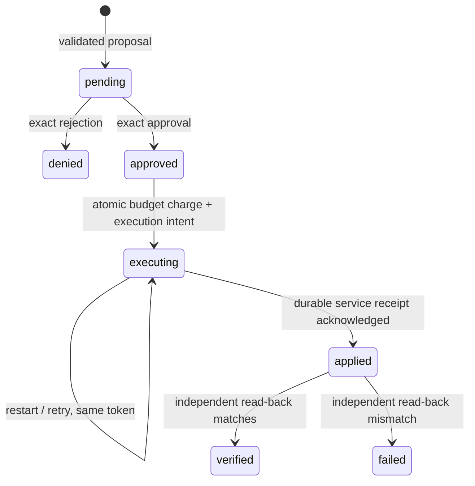

# Architecture and guarantees

## Components and authority

The embedding host constructs `Runtime`, owns both database paths, and mints role-scoped actors. Agent-facing code should receive only its role's methods/capability, never the Runtime object or actor factory. The offline planner and provider planners only return validated proposals. No provider can choose spend, tools, approval, or execution status. The separate verifier is deterministic code with a verifier capability, not a second model persuaded by the planner.

The CLI combines these roles as an explicit trusted demonstration harness. It is not an identity provider, sandbox, multi-user service, or defense against malicious JavaScript in the same process. Actor IDs are audit labels, not authenticated identities. Scope checks apply to mutations; `snapshot` and audit access are host-level inspection methods, not scoped agent read APIs. No third-party code is loaded.

## State machine

Denied and failed are terminal. Budget exhaustion leaves an approved intent unexecuted, with a denial audit entry. There is no mutable proposal or automatic escalation. A transient adapter error leaves executing work available for explicit recovery. A verifier read error leaves applied work available for retry; a confirmed evidence mismatch becomes failed. Failed evidence is never automatically repaired or hidden.

## Transaction and crash protocol

1. A runtime transaction checks actor role/scope, exact approval and remaining budget, charges 3 credits, records `executing` and the audit event, then commits.
2. The simulated service opens its own database transaction and inserts `(token, payload, receipt)` only if the token is absent. Existing tokens must match payload exactly.
3. A runtime transaction acknowledges the receipt and records `applied` plus audit.
4. Verification reads the effect through a new read-only SQLite connection and compares the token-bound receipt and exact payload. It then stores evidence, terminal status and audit atomically.

A crash before step 1 commits leaves no charge. A crash after it commits retains both charge and intent. Replaying step 2 can run more than once but creates one ledger row. A crash before acknowledgment commit leaves `executing`; recover safely repeats step 2. Multiple local workers serialize budget changes with SQLite locking; acknowledgment is idempotent. This is at-least-once delivery with an idempotent simulated effect, not a general distributed exactly-once guarantee.

Spend is conservative attempted-execution accounting. Once charged it is never refunded, including failure, missing effects, or verification mismatch. It represents neither live money nor provider token cost. Database cap and spend are safe integers at ingress; each increment is checked against remaining cap within one transaction. Reopening does not reset or raise the cap.

Each runtime database must have its own dedicated service database. Reusing a service database across independent runtimes is unsupported because intent digests have no tenant namespace. Service records are immutable receipts of simulated writes; this MVP does not implement last-write-wins mutable resources, external HTTP side effects, or rollback of real-world actions.

## Audit and limits

Audit entries include actor, operation, details, prior hash and current hash in the same transaction as runtime state changes. Denied operations roll back before a separate denial-audit transaction. If the database itself is unavailable, denial logging is best effort. `checkAudit()` detects modification of existing entries; there is no trusted external checkpoint, signature, timestamp, or protection against a privileged editor rewriting/truncating the entire chain. State transitions do not automatically enforce audit integrity. Local filesystem administrators can modify both state and evidence.

Durability relies on SQLite, the local filesystem, and storage honoring synchronization. Process-death tests are not power-loss, disk corruption, NFS, distributed consensus, or failover tests. The default busy timeout is five seconds; lock-timeout errors require operator retry. Backup/restore, schema migration, bounded retention and encryption are not implemented. Audit and evidence contain proposal text: use nonsensitive demo data.

The crash switches on `execute` intentionally call `process.exit` for test fault injection and must not be exposed to untrusted callers. A provider response is treated as untrusted input and strictly schema-validated; semantic accuracy of arbitrary model prose is outside the verifier's guarantee. Verification proves the requested simulated effect was recorded, not that the user's broader business objective was correct.

The runtime does not yet bind a persisted service-store identity. Keep the original runtime/service database pair at the same paths throughout restart and recovery. Replacing, deleting, restoring only one side, or repointing the service store is unsupported and can invalidate idempotency guarantees. Introduce a persisted service identity and coordinated restore protocol before external adapters. Demo auto-approval is fixture setup, not evidence of human authentication or consent in a deployed system.
